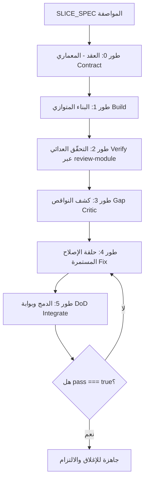

# build-slice — شريحة كاملة بفريق وكلاء، بلا تعارض

تُنجز شريحةً واحدة من الصفر إلى ١٠٠٪ وفق القاعدة الحاكمة (CLAUDE.md §٤): **خلفية + واجهة + `pnpm check` + تحقّق + ظهور في التنقّل = ١٠٠٪**. تتعاون إلزامياً مع نظام التنسيق (`scripts/coord.mjs`) كي لا تصطدم جلستان.

## الخطوات (نفّذها بالترتيب)

### ١) بوّابة بدء الجلسة (إلزامية — قبل أي شيء)
- نفّذ `pnpm coord:status` و `pnpm coord:list`. راجع أيضاً `mcp__ccd_session_mgmt__list_sessions` لمعرفة الجلسات الحيّة.
- **إن كنت على `main`:** توقّف. الكتابة على main محظورة بـ hook. أنشئ جلسة معزولة: `pnpm session:new <sliceId>` ثم تابع داخل مجلّدها (فرع `session/<sliceId>` + قاعدة/منفذ مستقلّان). لا تكمل على main.
- إن وجدت WIP غير ملتزم لجلسة أخرى أو شريحة مُدّعاة تتقاطع مع هدفك ⇒ اختر شريحة أخرى أو نسّق مع المالك. **لا تطمس عمل غيرك.**

### ٢) حدّد مواصفة الشريحة (SLICE_SPEC)
من وسيط المستخدم أو من «الخطوة التالية المقترحة» في CLAUDE.md §٦. كوّن:
```
{ sliceId, title, goal?, entities?, needsSchema?, needsSeed?, budget? }
```
- `sliceId`: kebab-case يطابق فرع `session/<sliceId>` (مثل `work-orders`).
- `needsSchema=true` إن لزم تعديل `drizzle/schema.ts` (ملف ساخن — يُطبَّق مبكراً بيد القائد + `pnpm db:push`).

### ٣) ادّعِ الشريحة (قفل ذرّي يمنع السباق)
- `pnpm coord:claim <sliceId> --files <أنماط ملفاتك> --title "<العنوان>"`.
- إن خرج برمز **3 (متنازَع)** ⇒ شريحة أخرى تملكها جلسة حيّة: اختر شريحة مختلفة. رمز **4 (معطوب)** ⇒ `pnpm coord:reclaim <sliceId>` ثم أعد الادّعاء.
- أعلِن الملفات المملوكة بدقّة (كاتب واحد لكل ملف). **لا تُدرج الملفات الساخنة** (`server/routers.ts`، `client/src/App.tsx`، `client/src/components/AppLayout.tsx`، `drizzle/schema.ts`، `server/seed.ts`) — تُدمج أخيراً.

### ٤) تنفيذ ورشة الوكلاء (سير العمل المفصول والمباشر)



يُدار سير العمل عبر أطوار متسلسلة ومتوازية مباشرة دون الاعتماد على مشغّل workflows قديم:
- **طور العقد (Contract):** المعماري يثبّت عقد API ↔ UI وملكية الملفات بدقة (كاتب واحد لكل ملف)، ويحدد التعديلات المؤجلة للملفات الساخنة (`server/routers.ts`، `client/src/App.tsx`، `client/src/components/AppLayout.tsx`، `drizzle/schema.ts`، `server/seed.ts`).
- **طور البناء (Build):** كتّاب متوازون ينجزون الملفات المخصصة ضد العقد في بيئات عمل معزولة، مع الالتزام بعدم لمس الملفات الساخنة.
- **طور التحقّق العدائي (Verify):** مراجعة عدائية عبر مهارة `review-module` (`.claude/skills/review-module/SKILL.md`) بأربع عدسات فحص (الصحّة والذرّية، الأموال والدفتر، الواجهة والربط، الأمان والصلاحيات).
- **طور ناقد الاكتمال (Gap):** كشف النواقص وشاشات التنقّل والاختبارات المفقودة لضمان جاهزية الشريحة وفق القاعدة الحاكمة (خلفية+واجهة+فحص+تحقق+تنقل=١٠٠٪).
- **طور حلقة الإصلاح (Fix):** حلقة إصلاح متكررة للملاحظات المؤكدة مجمّعة لكل ملف مع إعادة الفحص الدوري (`pnpm check` و `pnpm test`).
- **طور الدمج وبوابة DoD (Integrate):** القائد يحجز قفل `_integration`، ويطبّق تعديلات الملفات الساخنة، ويشغّل `pnpm check` و `pnpm test`، ويجري الجولة البصرية للتحقق.
- **شرط الإنجاز:** **لا تَعُدّ الشريحة منجزة ما لم تكن كافة أبعاد DoD الستة محقّقة بأدلّة آلية صريحة (`pass === true`)**.

#### مخطط العقد (Contract Schema):
```json
{
  "sliceId": "اسم الشريحة",
  "router": { "mountKey": "المفتاح في server/routers.ts", "file": "مسار ملف الراوتر" },
  "procedures": [
    {
      "name": "اسم الإجراء",
      "kind": "query | mutation",
      "input": "وصف مدخل zod نصاً",
      "output": "وصف المخرج المتوقع",
      "protection": "public | protected | admin",
      "atomicity": "قاعدة الذرية withTx",
      "money": "قواعد الدقة المالية decimal"
    }
  ],
  "ownedFiles": [
    {
      "path": "مسار الملف",
      "role": "service | router | page | test | helper",
      "writer": "معرّف الكاتب"
    }
  ],
  "hotFileEdits": [
    {
      "file": "server/routers.ts | client/src/App.tsx | client/src/components/AppLayout.tsx | drizzle/schema.ts | server/seed.ts",
      "edit": "نص التعديل المؤجل للدمج"
    }
  ],
  "screens": [
    {
      "path": "مسار المكون",
      "route": "مسار SPA",
      "navLabel": "تسمية القائمة في AppLayout",
      "purpose": "الغرض التشغيلي للشاشة"
    }
  ]
}
```

#### مخطط نتائج البناء (Write Result Schema):
```json
{
  "file": "مسار الملف",
  "status": "done | partial | blocked",
  "exports": ["قائمة الدوال والمكونات المصدرة"],
  "contractDeviations": ["أي انحراف عن العقد يستدعي معالجة"],
  "notes": "ملاحظات الكاتب ومتطلبات الملفات الساخنة"
}
```

#### مخطط نواقص الاكتمال (DoD Gaps Schema):
```json
{
  "gaps": [
    {
      "title": "عنوان النقيصة",
      "kind": "screen | nav | flow | test | unverified-claim | money | atomicity | other",
      "file": "الملف المعني",
      "why": "لماذا تمنع النقيصة بلوغ 100%"
    }
  ]
}
```

#### مخطط بوابة DoD النهائية (DoD Gate Schema):
```json
{
  "backend": { "ok": true, "evidence": "دليل جاهزية إجراءات tRPC والخدمات وقواعد البيانات" },
  "frontend": { "ok": true, "evidence": "دليل ربط الشاشات ومعالجة الحالات (تحميل/خطأ/فارغ)" },
  "check": { "ok": true, "output": "نتيجة تنفيذ pnpm check (صفر أخطاء)" },
  "tests": { "ok": true, "output": "نتيجة تنفيذ pnpm test الخضراء" },
  "nav": { "ok": true, "evidence": "دليل ظهور الشاشة ومسارها في AppLayout و App.tsx" },
  "visual": { "ok": true, "evidence": "دليل الجولة البصرية ولقطة الشاشة السليمة" },
  "pass": true,
  "summary": "تقييم تحليلي صريح لتحقق كافة أبعاد الجودة"
}
```

### ٥) الإغلاق
- **إن `pass`:** التزم على فرع الجلسة فقط: `feat(<sliceId>): <title> — شريحة رأسية كاملة (DoD ١٠٠٪)` مع تذييل `Co-Authored-By`. الدمج إلى `main` قرار/خطوة منفصلة بعد المراجعة.
- **إن لم تَمُرّ:** أبلِغ بالأبعاد الناقصة + الملاحظات المتبقّية. لا تلتزم نجاحاً. اترك الفرع للمتابعة.
- حرّر الادّعاء عند الفراغ: `pnpm coord:release <sliceId>` (والتكامل إن ادّعيته: `pnpm coord:release _integration`).

## مبادئ ثابتة
- **القائد لا يفوّض التنسيق:** الادّعاء/التحرير/تعديل الملفات الساخنة بيد الجلسة المنسّقة، لا وكيلٍ متوازٍ.
- **الباني لا يصادق نفسه:** المحقّقون وكلاء مستقلّون موجّهون للدحض؛ بوّابة DoD تُحسب من أدلّة آلية (`pnpm check`/`pnpm test` + لقطة شاشة) لا من ادّعاء كاتب.
- **قرارات مصيرية للمالك:** سياسة مالية/حذف بيانات (ضريبة، سقف ائتمان، دفع زائد) ⇒ توقّف واسأل قبل الادّعاء.
