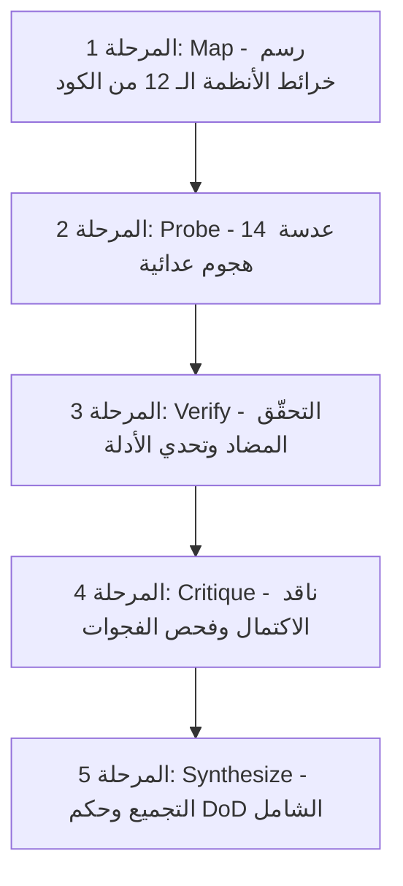

# financial-integrity-audit-fresh — التدقيق العدائي للسلامة المالية والمحاسبية

تُنفِّذ هذه المهارة فحصاً عميقاً ومستقلاً بنسبة 100% للسلامة المالية، المحاسبية، النقدية، والمخزنية لنظام إدارة أعمال الرؤية العربية. الفحص مبنيّ كلياً على قراءة الشيفرة البرمجية الفعلية وسلوكها التشغيلي دون الاعتماد على أي وثائق سابقة أو تقارير أو افتراضات.

---

## 1. القاعدة الصارمة الحاكمة (بروتوكول Zero-Hallucination & Fact-Check)

> **قاعدة صارمة لا تُخرَق — أي تقرير يخالفها يُعتبر باطلاً ومرفوضاً:**

### الممنوعات القطعية:
ممنوع منعاً باتاً قراءة أو استدعاء أي من:
- `CLAUDE.md` أو أي ملف markdown (`*.md`) في الجذر.
- مجلد `docs/` بأكمله (التقارير السابقة، الخطط، والمراجعات نقدّر حجيتها بصفة الصفر).
- مجلد `.claude/` ومجلد `~/.claude/` (التعليمات، الخطط، وسجلات الذاكرة السابقة).
- أي ملف وثائقي أو تقريري أو ملاحظات تحوي كلمات `REVIEW`، `audit`، `plan`، `memory`، أو `status` في مساره أو اسمه خارج مجلدات الشيفرة الإنتاجية؛ ويُسمح صراحةً بفحص ملفات الشيفرة البرمجية الفعلية في مساراتها الرسمية مثل `server/services/auditService.ts` و `server/routers/auditRouter.ts` و `shared/workOrderStatus.ts`.
- `README`، `CHANGELOG`، أو أي وثيقة وصفية للمشروع.
- ملفات الاختبارات (`*.test.ts`) كمصدر وحيد للحقيقة — لا يجوز استنتاج «المنطقة آمنة لأنّ لها اختباراً»؛ بل يجب فحص السلوك البرمجي الفعلي.

### المسموح بقراءته فقط:
- `server/` (الخدمات services، الراوترات routers، المصادقة auth، المعاملات `tx.ts`، السياق `context.ts`، ونقاط `trpc.ts`).
- `client/src/` (الصفحات والمكوّنات والمساعدات في الواجهة).
- `drizzle/` (المخطط `schema.ts` وهجرات قاعدة البيانات).
- `shared/` (الأدوات والأنواع المشتركة مثل دوال الأموال `money.ts`).
- `package.json` (لفهم التبعيات التقنية وإصداراتها فقط).

> **المبدأ:** تعامل مع النظام كأنك ترى الكود لأول مرة. لا تثق في تعليق ولا اسم متغير — اقرأ السلوك البرمجي الفعلي. الادعاءات في التوثيق ليست حجة ولا قرينة.

---

## 2. المراحل الخمس للتدقيق (The 5 Audit Phases)



---

## المرحلة 1: رسم الخرائط البرمجية (Phase 1: Map)

يتم تشغيل 12 خريطة فحص متخصصة مشتقة من الكود الفعلي فقط عبر استعلامات دقيقة:

### الخرائط الـ 12:
1. **`schema-money-fields` (حقول الأموال في المخطط):**
   قراءة `drizzle/schema.ts` بالكامل. حصر وتصنيف كل حقل مالي (`decimal` / `numeric` / `varchar`). تصنيفها: فواتير، بنود، مدفوعات، دفتر، أرصدة، حركات، تكاليف. تدقيق القيود (`UNIQUE`، `FK`، `DEFAULT`).
2. **`money-utility` (أدوات الحساب المالي):**
   البحث بـ Glob عن `shared/**/money*` و `shared/**/decimal*` و `server/**/money*`. تحليل دوال التحويل، التقريب، وصيغة الحفظ. فحص بالـ Grep عن أي استخدام لـ `parseFloat` أو `parseInt` أو `Number()` في خدمات وموجّهات الخادم.
3. **`transactions` (المعاملات والذرّية):**
   قراءة `server/services/tx.ts` وفهم دلالة `withTx`. حصر كل ملفات `server/services/*.ts`، وتحديد هل تستعمل `withTx`؟ وكم جدولاً يُكتب في كل عملية؟ وهل توجد كتابات تجري خارج المعاملة؟
4. **`inventory` (سلسلة المخزون):**
   قراءة `server/services/inventoryService.ts` وتتبّع `applyMovement` سطراً بسطر. فحص كل مستدعيها وكل من يكتب جدول `branchStock` مباشرة، مع حصر أنواع الحركات المدعومة في مخطط Drizzle.
5. **`cash-shift` (حركات الصندوق والورديات):**
   قراءة خدمات الورديات والنقدية (`server/services/*shift*`، `*cash*`، `*handover*`). تتبع فتح الوردية، نسبة المبيعات النقدية للوردية، إغلاق الوردية، وتدفق التسليم (Handover).
6. **`ledger` (دفتر اليومية المزدوج):**
   فحص مواقع إدراج وتحديث وحذف `journalEntries` في `server/`. تحديد العمليات المحركة (بيع، شراء، مرتجع، دفع، تحويل، إغلاق)، إشارات المبالغ، والقيود (`debit/credit` مقابل `amount/sign`).
7. **`balances` (أرصدة العملاء والموردين):**
   فحص مواقع تحديث `currentBalance` في جدولي `customers` و `suppliers`. التأكد من وجود `withTx` ووجود قيد دفتر يومية مرافق لمنع أي انحراف (Drift).
8. **`rbac-procedures` (إجراءات التحكم بالصلاحيات):**
   قراءة `server/trpc.ts` وفحص كافة الإجراءات (`publicProcedure`، `authProcedure`، `cashierProcedure`، `managerProcedure`، `adminProcedure`). مطابقتها مع استخداماتها الفعلية في كافة الراوترات.
9. **`routers-surface` (سطح نقاط الاتصال):**
   حصر كافة ملفات `server/routers/*.ts`، وتعداد الاستعلامات والعمليات (`query` / `mutation`)، ومخططات المدخلات Zod ومستويات الحماية للمسارات المالية والمخزنية.
10. **`cross-module-flows` (التدفقات المتقاطعة بين الوحدات):**
    تتبع المسارات التي تعبر عدة وحدات: تحويل أمر الشغل إلى فاتورة وتسليمها، استلام المشتريات وتحديث الذمم، المرتجعات، المصاريف، والتحويلات المخزنية بين الفروع.
11. **`auth-jwt` (المصادقة وهيكل الجلسات):**
    فحص `server/auth/*`، `server/middleware/*`، توليد رموز JWT، الحقول المتضمنة (`sub`، `role`، `branchId`، `sessionsValidFrom`)، وصلاحية الجلسات وعزل الفروع.
12. **`audit-service` (سجلات التدقيق الأمني):**
    فحص استدعاءات `auditLogs` و `auditService.log`، وتحديد العمليات المسجلة، والحقول المتضمنة (من، ماذا، متى، قبل، بعد)، ونسبة التغطية للعمليات الحساسة.

#### مخطط الخريطة (Map Schema):
```json
{
  "area": "اسم المنطقة",
  "keyFiles": [
    { "file": "مسار الملف", "role": "دور الملف في النظام" }
  ],
  "invariants": [
    "الثوابت والضمانات التي يفترض الكود صمودها"
  ],
  "riskHotspots": [
    {
      "description": "وصف نقطة الخطر",
      "file": "مسار الملف المستهدف",
      "suspicion": "سبب الاشتباه بالثغرة أو الخلل"
    }
  ]
}
```

---

## المرحلة 2: عدسات الهجوم العدائية (Phase 2: Probe)

يتم شن هجوم منظم عبر 14 عدسة تدقيق تهاجم الكود بافتراض «الكود مذنب حتى يثبت العكس»:

### العدسات الـ 14:
1. **`money-precision` (الدقة المالية وتفادي الفواصل العائمة):**
   البحث عن `parseFloat` / `Number()` / `parseInt` على حقول مالية، أو عمليات الجمع والطرح والضرب المباشرة على أرقام قاعدة البيانات دون استخدام مكتبة Decimal. فحص استخدام `toFixed` لأغراض الحفظ.
2. **`atomicity` (الذرّية وسلامة المعاملات):**
   فحص الخدمات التي تكتب في أكثر من جدول والتأكد من تغليفها بـ `withTx`. رصد أي استدعاءات قد ترمي استثناءات أو تستغرق وقتاً بعد بدء الكتابة (مثل الطباعة أو استدعاءات الشبكة الخارجية).
3. **`concurrency` (التزامن وسباقات القراءة والتعديل):**
   فحص عمليات Read-Modify-Write على `branchStock`، `cashRegister`، `currentBalance`، وتوليد أرقام الفواتير دون استخدام أقفال `for('update')` أو التحقق التفاؤلي، واختبار سيناريوهات البيع المتزامن لآخر قطعة.
4. **`idempotency` (حماية تكرار الطلبات):**
   تتبع `clientRequestId` وقيود `UNIQUE(sourceType, sourceId)`. اختبار سلوك النظام عند تكرار طلب البيع أو الدفع أو الصرف في حالات انقطاع الاتصال.
5. **`sign-convention` (اتساق إشارات الدفتر والذمم):**
   قراءة الكود الفعلي للتحقق من إشارات القيود: هل المرتجع سالب أم موجب؟ هل دفع المورد يقلل الرصيد الدائن؟ فحص أي مسار يشذ عن القاعدة المعمول بها.
6. **`isolation-idor` (عزل الفروع ومنع الوصول غير المصرح به):**
   التأكد من أن كافة الاستعلامات التي تأخذ معرفاً من العميل تطبق شرط `where(eq(table.branchId, ctx.user.branchId))` لمنع وصول مستخدم فرع إلى بيانات فرع آخر.
7. **`rbac-leakage` (صلاحيات الوصول وتسريب البيانات):**
   فحص تسريب تكلفة المنتجات أو أسعار الشراء في واجهات الكاشير، والتأكد من إزالة الحقول الحساسة على مستوى الخادم (Server Redaction) لا بإخفائها في واجهة المستخدم فقط.
8. **`balance-drift` (انجراف وتطابق الأرصدة):**
   التأكد من أن كل تعديل لـ `customers.currentBalance` أو `suppliers.currentBalance` يقابله قيد دفتر يومية متطابق. فحص مسارات الإلغاء والتسويات اليدوية.
9. **`inventory-invariants` (ثوابت المخزون وتفادي السلبية):**
   التحقق من أن الكميات بالوحدة الأساسية أعداد صحيحة (`int`)، والتأكد من استحالة وصول المخزون إلى قيم سالبة، وذرية التحويلات بين الفروع.
10. **`cash-shift` (سلامة الصندوق والورديات):**
    فحص نسبة الفواتير إلى الوردية المفتوحة، ومنع إضافة فواتير لوردية مغلقة، والتأكد من خصم المصاريف النقدية من رصيد الصندوق بذات المعاملة.
11. **`cross-module-trace` (التكامل الحرج بين الوحدات):**
    تتبع تسليم أوامر الشغل، استلام المشتريات الجزئية، المرتجعات، والتحويلات المخزنية للتأكد من عدم ترك النظام في حالة غير متسقة عند حدوث خطأ في المنتصف.
12. **`auth-session` (المصادقة وإدارة الجلسات):**
    فحص توكنات JWT، التحقق من صلاحية الجلسة عند تغيير دور المستخدم أو إبطاله، وتأمين ملفات تعريف الارتباط (`HttpOnly`، `SameSite`، `Secure`).
13. **`sql-injection-input` (التحقق من المدخلات وحقن البيانات):**
    البحث عن أي استخدام لـ `sql.raw` أو استعلامات نصية غير محمية بمدخلات المستخدم، وصرامة مخططات التحقق `zod`.
14. **`audit-coverage` (شمولية سجل التدقيق):**
    مقارنة العمليات الحساسة (تغيير الأسعار، حذف الفواتير، تعديل الأرصدة، عكس القيود) بمدى تسجيلها الفعلي في جدول `auditLogs`.

#### مخطط الملاحظات (Findings Schema):
```json
{
  "lens": "اسم العدسة",
  "findings": [
    {
      "title": "عنوان الملاحظة الدقيق",
      "severity": "critical | high | medium | low",
      "file": "مسار الملف",
      "locator": "رقم السطر أو اسم الدالة بدقة",
      "claim": "الادعاء الفني بالخلل",
      "evidence": "اقتباس نص الكود الفعلي الدال على الخلل",
      "impact": "الأثر التشغيلي أو المالي المباشر",
      "repro": "خطوات وسيناريو إعادة إنتاج الخلل إن أمكن"
    }
  ]
}
```

---

## المرحلة 3: التحقّق المضاد ودحض الملاحظات (Phase 3: Verify)

يخضع كل تقرير وكل ملاحظة خرجت من مرحلة الهجوم لاختبار مضاد متشكك من قِبل محقّق دفاعي:
- قراءة الملف مباشرة وإعادة التحقق من السياق البرمجي المحيط.
- البحث عن وجود صمامات أمان أو قيود قواعد بيانات تمنع حدوث السيناريو المشكو منه.
- في حالة الشك أو عدم كفاية الدليل، يُعتمد `refuted: true` وتُخفّض الخطورة إلى `not-a-bug`.

#### مخطط الحكم التحقيقي (Verdict Schema):
```json
{
  "refuted": false,
  "confidence": "high | medium | low",
  "reasoning": "التعليل الهندسي المستند لقراءة الكود",
  "counterEvidence": "الدليل المضاد إن وُجد",
  "revisedSeverity": "critical | high | medium | low | not-a-bug"
}
```

---

## المرحلة 4: ناقد الاكتمال وفحص الفجوات (Phase 4: Critique)

يقوم ناقد الاكتمال بفحص ما فات المراجعين والعدسات الـ 14:
- البحث في مسارات العمليات المالية غير الاعتيادية: إغلاق السنة المالية، التسويات البنكية، المعالجات بأثر رجعي، فروق أسعار الصرف، إلغاء الفواتير المسددة جزئياً أو كلياً، وحذف الكيانات المرتبطة بحركات محاسبية.
- اختيار أبرز الفجوات وتنفيذ جولة فحص موجهة واستخراج ملاحظات مثبتة بمراجع كود حرفية.

#### مخطط الفجوات (Gap Schema):
```json
{
  "gaps": [
    {
      "area": "المنطقة غير المغطاة كلياً",
      "question": "السؤال أو السيناريو غير المفحوص",
      "why": "المخاطرة المحتملة على سلامة البيانات المالية"
    }
  ]
}
```

---

## المرحلة 5: التجميع وحكم السلامة الشامل (Phase 5: Synthesize)

تجميع الملاحظات المؤكدة غير المدحوضة وصياغة التقرير الهندسي النهائي:
- حصر الملاحظات الحرجة (`critical`) والملاحظات العالية (`high`) مع صياغة حل برمجي (`fix`) مباشر لكل منها.
- سرد المناطق البرمجية السليمة (`healthyAreas`) التي صمدت أمام الفحص العدائي لتوفير رؤية متوازنة للنظام.
- تقديم الحكم النهائي الصريح وتحديد الشريحة البرمجية ذات الأولوية القصوى للإصلاح الفوري.

#### مخطط التقرير النهائي (Synthesize Schema):
```json
{
  "summary": "تشخيص عام لحالة السلامة المالية بناءً على الحقائق البرمجية المثبتة",
  "overallVerdict": "حكم نهائي صريح: سليم تماماً | يحتاج معالجات فورية قبل التوسع | خطر مالي جوهري",
  "criticalFindings": [
    {
      "title": "عنوان الخلل الحرج",
      "file": "مسار الملف",
      "severity": "critical",
      "impact": "الأثر الحرج",
      "fix": "الحل البرمجي المحدد"
    }
  ],
  "highFindings": [
    {
      "title": "عنوان الخلل عالي الخطورة",
      "file": "مسار الملف",
      "severity": "high",
      "impact": "الأثر الفني",
      "fix": "الحل البرمجي المحدد"
    }
  ],
  "mediumLowFindings": [
    { "title": "عنوان الملاحظة", "file": "مسار الملف", "severity": "medium | low" }
  ],
  "healthyAreas": [
    "قائمة بالمناطق والأنظمة التي ثبتت سلامتها البرمجية وخلوها من الثغرات"
  ],
  "recommendedNextSlice": "تحديد اسم ومسار الشريحة التالية الأنسب للإصلاح والتطوير"
}
```
