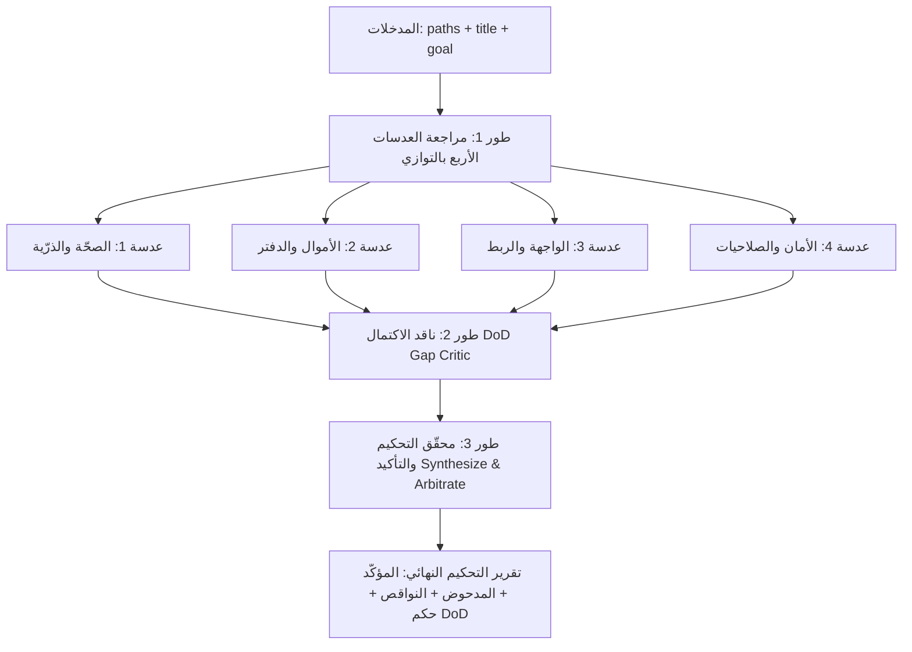

# review-module — مراجعة عدائية متعددة العدسات وتحكيم DoD

تُنفِّذ هذه المهارة مراجعةً عدائية للقراءة فقط وبلا تعارض لأي وحدة أو شريحة برمجية في النظام، بالاعتماد على ٤ عدسات فحص متخصصة، يليها ناقد اكتمال لاكتشاف النواقص، ثم محقّق تحكيم عدائي لتأكيد الأخطاء الحقيقية ودحض الإيجابيات الكاذبة.

---

## 1. الفلسفة والقاعدة الحاكمة

1. **التركيز على الأخطاء الحقيقية:** أبلغ عن أخطاء **حقيقية** فقط (تكسر ثابتاً، تفسد بيانات، تخرق ذرّية، تسرّب دقة مالية، أو تخالف الاتفاقيات الحاكمة). تُستبعد الملاحظات الأسلوبية والتفضيلات الشخصية تماماً.
2. **اتفاقيات المشروع المُلزِمة (CLAUDE.md):**
   - **الذرّية (Atomicity):** كل عملية متعددة الجداول داخل `withTx`؛ أي استثناء يرميه الكود يؤدي فوراً إلى `ROLLBACK`. ممنوع استدعاء I/O أو طباعة أو عمليات غير ذرية خارج أو وسط المعاملة.
   - **الأموال (Money):** الحسابات عبر `decimal.js` ومساعدات `shared/money.ts` أو `server/utils/money.ts`. ممنوع منعاً باتاً استخدام `parseFloat` أو `Number()` أو العمليات الحسابية المباشرة `+ - * /` على مبالغ العملات.
   - **المخزون (Inventory):** الحركات مسجلة بالوحدة الأساسية (صحيح int) عبر `inventoryService.applyMovement` تحت قفل صريح لمنع التسابق؛ المخزون لا يقبل السلبية غير المصرّح بها.
   - **الدفتر والذمم (Ledger & Balances):** كل تغيير في ذمم العملاء أو الموردين يُرافقه قيد دفتر يومية متزن ولا يقبل الازدواج.
   - **القاعدة الحاكمة:** **خلفية + واجهة + فحص + تحقق + تنقّل = ١٠٠٪**.

---

## 2. معلمات الإدخال (Inputs)

```typescript
interface ReviewModuleArgs {
  title: string;        // اسم الوحدة أو الشريحة (مثال: 'work-orders' أو 'supplier-payments')
  paths: string[];      // مسارات الملفات التابعة للوحدة (خدمات، راوترات، شاشات، نماذج)
  goal?: string;        // الهدف المرجو من الوحدة ومجال عملها الوظيفي
}
```

---

## 3. مراحل المراجعة (Phases)



### طور 1: مراجعة العدسات الأربع المتوازية (Review Phase)

تُفحص الملفات عبر ٤ عدسات مستقلة:

#### العدسة 1: الصحّة والذرّية (`correctness-atomicity`)
- فحص العمليات المكتوبة في قواعد البيانات: هل أي تعديل متعدد الجداول يجري خارج `withTx`؟
- فحص سباقات التزامن (Concurrency Races): قراءة ثم تعديل (Read-Modify-Write) دون أقفال `for('update')` أو إصدار تفاؤلي.
- حالات الحافة، السيناريوهات الجزئية، ورمي الأخطاء بعد بدء الكتابة.

#### العدسة 2: الأموال والدفتر (`money-ledger`)
- تسرّب أرقام الفاصلة العائمة (Floats): البحث عن `parseFloat`، `Number()`، `toFixed` للحفظ.
- التحقق من دقة التقريب وإشارات العمليات: المرتجع، الدفع، الخصم، الأرصدة الافتتاحية.
- قيود الذمم المدينة والدائنة (AR/AP): اتساق `currentBalance` مع جدول `journalEntries`، ومنع ازدواج الحسابات.

#### العدسة 3: الواجهة والربط (`ui-wiring`)
- ربط الشاشة بالواجهة الخلفية: هل الشاشة موصولة فعلياً بنقاط tRPC أم تعتمد على بيانات وهمية أو أزرار غير مفعّلة؟
- تغطية حالات دورة حياة البيانات: شاشة التحميل (Loading)، معالجة الأخطاء (Error)، والحالة الفارغة (Empty State).
- التحقق من المدخلات ومطابقة مخطط Zod مع نماذج الواجهة.
- ظهور الشاشة في التنقّل العام ومسارات التطبيق (`App.tsx` و `AppLayout.tsx`).

#### العدسة 4: الأمان والصلاحيات (`security-auth`)
- حماية الإجراءات: استعمال `protectedProcedure`، `cashierProcedure`، `managerProcedure`، أو `adminProcedure` المناسب.
- تسريب البيانات الحساسة: مثل ظهور تكلفة المنتجات أو الأرباح في مخرجات استعلامات الكاشير (DevTools leakage).
- عزل الفروع (IDOR & Branch Isolation): التحقق الإلزامي من وجود `where(eq(table.branchId, ctx.user.branchId))`.
- إحكام مخططات الإدخال `zod` ومنع حقن الاستعلامات.

#### هيكل مخرجات العدسة (Findings Schema):
```json
{
  "lens": "correctness-atomicity | money-ledger | ui-wiring | security-auth",
  "findings": [
    {
      "title": "عنوان موجز للملاحظة",
      "severity": "critical | high | medium | low",
      "file": "مسار الملف الدقيق",
      "problem": "شرح المشكلة الصريحة ولماذا تكسر النظام",
      "evidence": "اقتباس سطور الكود الدالة أو رقم السطر",
      "fix": "الحل البرمجي المقترح بدقة"
    }
  ]
}
```

---

### طور 2: ناقد الاكتمال (Gap Critic Phase)

يقف ناقد الاكتمال مستقلاً لتقييم الوحدة في ضوء القاعدة الحاكمة: **خلفية + واجهة + فحص + تحقق + تنقّل = ١٠٠٪**.
يجيب عن السؤال: **ما الذي ينقص هذه الوحدة لتكون شريحة رأسية مكتملة وجاهزة للإنتاج تماماً؟**

- **شاشة مفقودة (`screen`):** إجراءات في الخلفية لا توجد شاشة تقابلها في الواجهة.
- **تدفّق غير مكتمل (`flow`):** خطوة تترك الكيان في حالة معلقة بلا مسار إكمال أو تراجع.
- **اختبار ناقص (`test`):** مسار مالي أو ذرّي حرج دون اختبار وحدة أو تكامل يحميه من الانحدار.
- **ادّعاء غير متحقَّق (`unverified-claim`):** وظيفة يُزعم عملها دون دليل ملموس.

#### هيكل مخرجات النواقص (Gaps Schema):
```json
{
  "gaps": [
    {
      "title": "عنوان النقيصة",
      "kind": "screen | flow | test | unverified-claim | other",
      "why": "سبب اعتبارها نقيصة تعيق اكتمال الـ 100%"
    }
  ]
}
```

---

### طور 3: التحكيم والتأكيد العدائي (Synthesize & Arbitrate Phase)

يقوم المحقّق العدائي بمراجعة كل ملاحظة ونقيصة مباشرةً على الكود الحقيقي:
1. **فحص الدليل:** هل المشكلة قائمة فعلياً في السطر المذكور؟
2. **فحص الضمانات المضادة:** هل يوجد قيد فريد (UNIQUE constraint)، أو غلاف معاملة مسبق، أو فلتر عزل يُبطل الخطر؟
3. **التصنيف الصارم:**
   - **`confirmed` (مؤكَّد):** خطأ حقيقي مثبت بالدليل؛ يُرتب حسب الخطورة (`critical`، ثم `high`، ثم `medium`، ثم `low`).
   - **`rejected` (مدحوض):** إيجابية كاذبة؛ يُذكر سبب الدحض الصريح `whyFalse`.
   - **`missing` (نواقص مؤكدة):** قائمة النواقص المعتمدة لتضمينها في حلقة الإصلاح.

#### هيكل حكم التحكيم (Verdict Schema):
```json
{
  "confirmed": [
    {
      "title": "عنوان الخطأ الحقيقي",
      "severity": "critical | high | medium | low",
      "file": "مسار الملف",
      "fix": "خطوات الإصلاح المطلوبة"
    }
  ],
  "rejected": [
    {
      "title": "عنوان الملاحظة المدحوضة",
      "whyFalse": "دليل بطلانها من الكود والضمانات الحالية"
    }
  ],
  "missing": [
    "النواقص المؤكدة التي تمنع الـ 100%"
  ],
  "summary": "ملخص تحليلي صريح لحالة الوحدة وتقييم جاهزيتها للإنتاج"
}
```

---

## 4. مخرجات الاستخدام وطريقة التنفيذ

عند استدعاء المهارة في موجه الأوامر أو ضمن وكيل، تُنفَّذ بالترتيب التالي:
1. جمع الملفات المستهدفة عبر Glob أو قائمة صريحة.
2. تشغيل استعلامات العدسات الأربع على الكود الفعلي.
3. تشغيل ناقد الاكتمال واستخراج قائمة الثغرات والنواقص.
4. تنفيذ جلسة التحكيم وتوليد تقرير الحكم النهائي.
5. تمرير الملاحظات المؤكدة (`confirmed`) والنواقص (`missing`) إلى حلقة الإصلاح أو بوابة التحقق.
