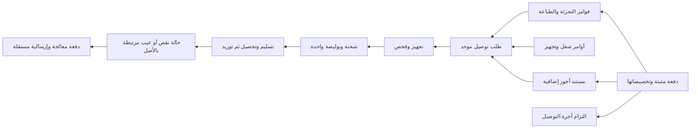

# التوصيل الموحد والقبض والأجور ومعالجة النقص بعد البيع

التاريخ: 2026-10-23. الحالة: **مواصفة مقترحة للاعتماد؛ ليست تنفيذاً أو إثبات نشر**.
مرجع المراجعة: `34bc5cb77b26413dcb2ec958f88893997ffd58e6`.

## 1. النتيجة المطلوبة

يشتري العميل من التجزئة والطباعة والتخصيص، ويدفع الآن أو عند الاستلام، وتصل مستنداته الجاهزة بطلب توصيل واحد وبوليصة واحدة وأجرة واحدة. تبقى المبيعات والقبوض منسوبة إلى مستنداتها وكاشيراتها الفعلية. يسمح الطلب بأجور تغليف وتجهيز خارجي موثقة، وبمعالجة نقص أو عيب لاحق دون بيع مكرر أو تحصيل مكرر أو خصم مخزون مرتين.

توضيح المالك: المقصود بالمبالغ الإضافية يشمل التغليف والتجهيزات والأشياء الخارجية. لا يُفترض أن كل مبلغ خارجي أمانة؛ بيع المكتبة لخدمة ينفذها متعهد يختلف عن تحصيلها مبلغاً بالنيابة عن ذلك المتعهد.

## 2. حدود التحقق والتنسيق

- تمت قراءة الشيفرة ومراجعتها بواسطة مراجعين مستقلين للتحصيل والتوصيل، وللنقص والمخزون.
- لم يُشغّل التطبيق أو SQL أو اختبارات في هذه المراجعة، ولم تُعدّل أرصدة أو مستندات إنتاجية.
- الصور مرجع لشاشة المستخدم وقت التصوير، وليست إثباتاً أن كل ما فيها يطابق النسخة المحلية أو الإنتاج الحالي.
- توجد ادعاءات حية على الاستقبال والتسويات والأجور ومحرك الترحيل. هذه المواصفة في جلسة مستقلة، ولا تمنح تصريحاً بتجاوز ملكية تلك الملفات.
- التنفيذ يتطلب اعتماد هذه العقود، ثم إعادة قراءة أحدث `main` وسجل التنسيق، وتنسيق ملكية الملفات الساخنة والهجرات. لا يثبت SHA أعلاه حالة الإنتاج الحالية.

## 3. الموجود والفجوات المثبتة

| المسار | ما تثبته الشيفرة | الدليل عند المرجع أعلاه |
|---|---|---|
| عدة فواتير بشحنة واحدة | موجود فعلاً: 2–30 فاتورة، قفل ومعاملة واحدة، أجرة وبوليصة على القائد، وحفظ استقلال الفواتير | `server/services/delivery/shipments.ts:285`, `:460`, `:497` |
| قبض الشحنة | توزيع المقبوض على الفواتير داخل معاملة، وحماية أعضاء الشحنة من الإجراءات المنفردة | `server/services/delivery/shipmentOperations.ts:199`; `server/services/delivery/shipments.ts:120` |
| المدفوع مسبقاً | COD يُحسب بعد المدفوع والمرتجع؛ دفع البضاعة لا يثبت وصول الطرد | `server/services/delivery/dispatchInvoice.ts:421`, `:496` |
| أجرة مقبوضة بالكاشير | تسجل حالياً CASH/DRAWER مهما كانت طريقة دفع البضاعة؛ لا تحقق دفع الجميع بالبطاقة | `server/services/delivery/feeHeld.ts:93`, `:109`; `server/services/receptionCheckoutService.ts:849`; `server/services/workOrder/create.ts:763` |
| تثبيت سلة مختلطة | يختار فاتورة البيع أو الطباعة الحاملة ويستدعي الإسناد مرة واحدة؛ لا يستعمل التجميع الموجود لكل نواتج السلة | `server/services/receptionCheckoutService.ts:895` |
| أمر شغل جاهز غير مفوتر | التجميع يستقبل invoiceIds، بينما فاتورة الأمر تنشأ في إسناده أو تسليمه؛ اختبار جمع فاتورة WORKORDER قائمة لا يثبت اكتمال هذه الرحلة | `server/services/delivery/shipments.ts:281`; `server/services/delivery/dispatch.ts:375`; `server/services/workOrder/deliver.ts:379`; `server/services/__tests__/deliveryMultiInvoice.test.ts:356` |
| أمانات أجور متعددة | التجميع يرفض وجود عدة حوامل لأمانة الأجرة، ويحتاج تسوية موثقة للفائض | `server/services/delivery/shipments.ts:464` |
| بيع البكج | يحفظ لقطة المكونات ويخصمها عند البيع نفسه | `server/services/sale/create.ts:1718`, `:1755`, `:1882` |
| استكمال نقص بعد البيع | الإرسالية الحالية تتطلب invoiceId؛ مصادرها لا تتضمن معالجة مستقلة، وإعادة إسناد الفاتورة المنفذة مرفوضة | `drizzle/schema.ts:13525`, `:13532`, `:13662`; `server/services/delivery/dispatchInvoice.ts:318` |
| المرتجع والهدية | المرتجع يعكس البيع ومكونات الجزء المرتجع؛ الهدية تخصم مخزوناً وتحمّل مصروفاً. كلاهما غير مناسب تلقائياً لنقص سبق خصمه | `server/services/returnService.ts:1675`, `:1724`; `server/services/gifts/outbound.ts:166` |
| المبالغ الحرة | توجد فئات محاسبية لسندات OTHER؛ ربط invoiceId فيها محصور بسند CUSTOMER، وليس بديلاً لتوزيع رسوم الطلب وأماناته | `shared/voucherCategoryAccounting.ts:1`; `server/services/voucher/create.ts:751`, `:1066` |

هذه حدود شيفرة مثبتة، وليست اتهاماً بوقوع عجز أو تحصيل مكرر في الإنتاج.

## 4. الاختيار المعماري

الاختيار الموصى به: **توسعة المسارات القائمة، وإضافة طلب توصيل سابق للإسناد، ومستند أجور، وحالة معالجة بعد البيع**. يبقى التجميع القائم نواة الإرساليات المالية، مع فصل المصادر التشغيلية عن مطالبات المال.

بديل دمج كل شيء بفاتورة جديدة يكرر البيع ويمحو نسبة العمل للكاشيرات، لذلك لا يعتمد. وبديل فاتورة صفرية/هدية لكل نقص يخصم المكونات أو التكلفة مجدداً في حالات لا تستحق ذلك. إعادة بناء منظومة التوصيل كاملة غير لازمة؛ الموجود يعاد استخدامه بعد إكمال عقوده.

## 5. الدفع الآن: نقداً أو بطاقة أو موزعاً بينهما

يفصل العقد بين أربعة أمور: ما يدين به العميل، ما قبضناه فعلاً، لمن تخص الأموال، ومن أي مصدر ندفع للناقل. لا تُستنتج طريقة قبض الأجرة من طريقة سداد الناقل لاحقاً.

1. يعرض الكاشير قيمة البضاعة/الخدمات، والأجور الإضافية المصنفة، وأجرة التوصيل، والعربون السابق، والمطلوب الآن والمتبقي عند الاستلام كلّاً بوضوح.
2. يختار الموظف وسيلة القبض الفعلية. بطاقات/تحويل/محفظة تتبع عقد الإثبات القائم؛ النقد وحده يؤثر في الدرج. لا ينشأ قبض نقدي مقابل أجرة دفعها العميل بالبطاقة.
3. الدفعة تحمل تخصيصات صريحة لكل فاتورة أو مستند رسم أو التزام أمانة. مجموع التخصيصات يساوي المبلغ المثبت، ولا ترفع حصة الأجرة `invoices.paidAmount`.
4. قبض موحد لا يعني فاتورة موحدة: يمكن طباعة وصل جامع واحد بأرقام المستندات وتخصيصاتها. إن أنتجت البنية إيصالات فرعية، ترتبط برأس قبض واحد ولا تدخل الإجمالي مرتين.
5. عملية بطاقة واحدة لها إثبات واحد يُستهلك مرة واحدة عند رأس القبض، لا يُعاد استخدامه كعمليات مستقلة لكل تخصيص. لا يستدعي إعادة الطلب خصماً خارجياً جديداً. نجاح الدفع الخارجي وفشل معاملة MySQL لا يعيدان المال تلقائياً: يبقى الإثبات محفوظاً بحالة «مقبوض غير مخصص/قيد الاسترداد»، ويعاد تخصيص الإثبات نفسه أو رده بمسار موثق. لا يظهر المبلغ كأنه لم يُقبض ولا يطلب من العميل دفعه مجدداً.
6. القبوض السابقة تحتفظ بوردية قابضها وطريقتها ومرجعها. ضم فواتير مدفوعة لا يولد إيصالات أخرى ولا ينقل النقد إلى درج من قام بالتجميع.
7. أجرة الناقل الممررة أمانة وليست إيراد مبيعات. الافتراضي تمرير أجرة الناقل بلا هامش. إن تحملت المكتبة جزءاً، يثبت الجزء كمصروف عليها صراحة، ولا يظهر ديناً على العميل. لا يقبض أكثر من المستحق للناقل باسم الأمانة: الزيادة ترد، أو تكون أجر خدمة مستقل مصنف ومعتمد ظاهر للعميل. إذا لم تُحدد الجهة بعد، تبقى الأمانة منسوبة للعميل والطلب إلى حين تحديد الاستحقاق وتخصيصه أو رده.
8. دفع الناقل نقداً بعد قبض العميل بالبطاقة صرف حقيقي من مصدر متاح ومخول. إن لم يتوفر نقد، يبقى الاستحقاق قائماً أو يسدد من قناة معتمدة؛ لا يختلق النظام IN نقدياً كي يسمح بـOUT.
9. الرد يعالج تخصيصاته الأصلية والوسيلة المعتمدة، ويمنع تجاوز صافي المقبوض. إلغاء التوصيل لا يعكس بيعاً صحيحاً؛ يُسوّى فقط ما استحق فعلاً من الأجرة ويُرد ما لم يستحق وفق القرار الموثق.

مثال قبول: فواتير بقيمة 50,000 وأجرة ناقل 5,000، ودفع بطاقة 55,000. المقبوض غير النقدي 55,000، تسديد الفواتير 50,000، أمانة الناقل 5,000، أثر الدرج صفر، وCOD صفر. سداد الناقل لاحقاً نقداً يخفض النقد الحقيقي 5,000 ويبرئ الالتزام، دون مصروف توصيل جديد أو تعديل مبيعات.

## 6. طلب واحد من عدة كاشيرات

طلب التوصيل حافظة تشغيلية تسبق الإسناد، ويظهر من الاستقبال وكل كاشير مخول: «أضف إلى طلب توصيل» أو «طلب توصيل جديد». يمكن البحث بجزء من الاسم أو الهاتف المحلي أو رقم الفاتورة/أمر الشغل.

- يحدد الطلب العميل والمستلم والهاتف والعنوان والفرع وجهة التوصيل والأجرة. لا يجمع عملاء مختلفين بسبب اسم متشابه أو حساب «زبون نقدي» عام. للعميل العابر يلزم هاتف متحقق وربط صريح للمستندات.
- يحتفظ كل سطر بمصدره: فاتورة أو أمر شغل. يُعرض «بانتظار التجهيز/جاهز/ضمن الإرسالية/سُلّم» إلى جانب حالة الدفع، فهما مستقلتان.
- الافتراضي انتظار جميع البنود. الإرسال الجزئي يتطلب قراراً صريحاً يبين المتبقي وأجرته اللاحقة؛ لا يخرج جزء تلقائياً لأن فاتورة البضاعة صدرت قبل التخصيص.
- جمع فواتير قائمة يعيد استعمال التجميع القائم. الأمر الجاهز غير المفوتر يمر بتوليد مستنده من مساره المعتمد مرة واحدة، مع ربطه بالطلب وتخصيص العربون دون قبض أو استهلاك خامات جديد.
- تثبيت السلة المختلطة يرتبط بهذه الحافظة؛ لا يرسل الفاتورة الحاملة وحدها ويترك الباقي خارجها دون تنبيه.
- عند الإطلاق: قفل الطلب والمصادر بترتيب ثابت، إعادة تحقق الجاهزية والعميل والفرع والمدفوع والمرتجع، تثبيت الأعضاء والأجرة والبوليصة مرة واحدة، ثم التزام المعاملة كلها أو تراجعها كلها.
- تبقى قيود الفروع والصلاحيات وSLA والحدود الحالية. لا يضاف تجاوز عام لها. الجمع بين فروع يحتاج نقل عهدة وبضاعة مثبتاً، وليس السماح الضمني بجمعها.
- الأمانات السابقة المتعددة تُعرض بأصولها. يخصص منها المستحق مرة واحدة وترد الزيادة أو تبقى التزاماً معتمد الغرض؛ لا تمتص كإيراد أو أجرة إضافية صامتة.
- قبض أثناء الطريق يعيد حساب المطلوب من الجهة ذرياً ويرفع نسخة مطالبة التحصيل، مع إخطار الناقل وإقرار وصول التعديل قابلين للتتبع. يظهر «القبض مثبت، تعديل مطالبة الناقل بانتظار الإقرار» حتى التأكيد؛ الورقة المطبوعة أو الجهاز المنقطع قد يحملان النسخة القديمة. إذا قبض الناقل المبلغ القديم فعلاً، يثبت المقبوض الزائد وعهدته كالتزام رد للعميل، ويعاد بمستند موثق دون بيع أو تخصيص جديد للفاتورة. لا يُخفى النقد الحقيقي بسبب رفض سقف التخصيص، ولا يؤخذ فرق الصفر على أنه تسليم فعلي.

## 7. أجور التغليف والتجهيز الخارجي

تضاف من زر «أجور ومبالغ إضافية» بمستند مرقم مرتبط بالعميل والطلب، لا بصنف مخزني وهمي. يلزم بيان ومبلغ وتصنيف وجهة مستفيدة ومن يتحمله ومصدره. المبالغ المجهولة لا تُرحّل تحت «أخرى» تلقائياً.

| طبيعة المبلغ | المعالجة المقترحة | أثره على المخزون |
|---|---|---|
| أجر تغليف/تجهيز للمكتبة | إيراد خدمة مصنف بمستند الأجور؛ ذمة وتسديد مستقلان عن قيمة بضاعة الفاتورة | لا حركة تلقائية |
| تجهيز تبيعه المكتبة وينفذه متعهد | أجر العميل إيراد خدمة؛ تكلفة المتعهد مستند مصروف/استحقاق مستقل. يظهر الإجمالي والتكلفة والهامش، ولا يكتفى بالفرق الصافي | استهلاك المواد الفعلية فقط إن وجدت |
| مبلغ نحصل عليه لحساب جهة خارجية بالنيابة | أمانة/التزام منسوب للجهة والعميل؛ إبراؤه عند السداد أو الرد، بلا إيراد للمكتبة | لا حركة |
| تجهيز/توصيل تتحمله المكتبة | مصروف/استحقاق مرتبط بالسبب والمستفيد، ولا يضاف للمطلوب من العميل | حسب المواد المصروفة فعلياً |

عدم ارتباط الأجر بمنتج لا يعني أن مواد التغليف مجانية أو خارج الرقابة: إذا استُخدمت أكياس/علب مخزنية، يصرف النظام استهلاكها بمستند تجهيز مستقل مرة واحدة؛ وصف الأجر وحده لا ينشئ صرفاً افتراضياً.

يظهر المستند في الوصل الجامع وكشف العميل وتقارير الأجور والخزينة وتسوية الجهة وفق طبيعته. إذا دُفع للمتعهد مسبقاً فلا ينشأ مصروف ثان عند التسليم. العكس والرد لهما مرجع إلى الأصل، ويُمنع حذف مستند مرحل أو تغيير تصنيفه بعد القبض بلا عكس موثق.

تحصيل المندوب يرتبط بمطالبات مصنفة: فاتورة، أجر مكتبة، أو مبلغ محصل بالنيابة. لكل مطالبة أصل ومتبق وتخصيصات تحصيل/توريد/رد؛ لا يستعمل `invoice.paidAmount` لتسديد التغليف أو الأمانة. إذا كانت كل الفواتير مسددة وبقي تغليف 2,000، يكون COD=2,000 لمستند الأجور وحده؛ لا تنشأ فاتورة حاملة ولا يتغير سداد الفواتير. والمستند المستقل بلا فاتورة يمكن قبضه في الكاشير أو تضمينه بطلب توصيل ذي مصدر طلب صريح. الأجور المؤجلة تحتاج طرفاً معروفاً وضابط الائتمان أو التحصيل عند الاستلام؛ لا ذمة مجهولة.

الطلب المختلط يعرض حسابين منفصلين: «المطلوب من العميل» و«المستحق للجهات». لا تدخل كل المبالغ الإضافية وعاء عمولة المبيعات تلقائياً؛ تصنيف الأجور المستحق للعمولة يحتاج سياسة صريحة، والافتراضي إخراجها من عمولة بضاعة الفاتورة.

## 8. نقص البكج والتعويض بعد الإقفال

ينشئ الموظف «حالة معالجة بعد البيع» من الفاتورة أو أمر الشغل أو الإرسالية أو سجل العميل، مع السبب والبنود والمكونات والكمية والأدلة. يبقى البيع والتحصيل والتوريد القديم محفوظاً. لا تعاد فتح التسوية القديمة لإرسال النقص.

### أ. نقص تجهيز بقي بالمحل وسبق خصمه عند البيع

هذا استكمال لالتزام التسليم، لا بيع أو هدية جديدة. يجب إثبات الصنف والكمية المخصومين وربطهما بحركة الأصل ولقطة مكونات البكج، ثم تثبيت وجود القطعة وفصلها فعلياً تحت عهدة العميل.

مثال: الموجود قبل البيع 10. بيع البكج خصم قطعة فصار الرصيد المملوك 9، لكن القطعة بقيت بالمحل. الفعلي 10 = مملوك 9 + مبيع بعهدتنا 1. عند إرسال النقص يصبح الفعلي 9، ويبقى الرصيد الدفتري 9. **لا OUT جديد، ولا COGS، ولا إيراد، ولا ذمة أو عمولة جديدة.**

تُدار القطعة بسجل تنفيذ/عهدة بضاعة مبيعة، لا بحجز عادي يخصم من `branchStock` مرة ثانية. يظهر هذا الفرق في الجرد: المبيع بعهدة المحل ليس زيادة مخزون مملوك. إذا كان جرد سابق أعاده للمملوك أو تعذر إثبات الخصم/وجود القطعة، تتوقف هذه المعالجة إلى تحقيق واعتماد؛ لا يسمح بزر عام «بدون خصم».

### ب. فقد أو تلف أو قطعة بديلة إضافية

صرف قطعة جديدة من المملوك حركة إضافية واحدة بتكلفة المخزون المعتمدة وقت الصرف، مقابل مصروف جودة/تعويض مصنف. صفر إيراد أو ذمة أو عمولة جديدة. لا تُحمّل تكلفة القطعة الأصلية ثانية، ولا يعاد المخزون للتالف قبل وصوله وفحصه. إن أعيدت قطعة قابلة للاستخدام، تكون العودة مثبتة إلى موقع صالح/حجر ثم تقييمها وفق مسارها، دون اعتبارها مرتجع بيع تلقائياً.

المسؤولية «المكتبة/الناقل/موظف» نتيجة تحقيق، وليست إذناً تلقائياً بخصم راتب أو إنشاء دين. المطالبة على المسؤول لها مستند واعتماد منفصلان ولا تعفي التزامنا تجاه العميل.

### ج. إعادة طباعة أو تصنيع

أمر معالجة مرتبط بالأصل يستهلك الخامات الجديدة والعمل الإضافي الفعلي وحده وفق نموذج التكلفة القائم، ويحمل مصروف الجودة/المعالجة. إرسال قطعة سبق إنتاجها يختلف عن إنتاج بديل جديد. لا يستعمل عكس تسليم أمر الشغل لإعادة طباعة مجانية مع بقاء البيع صحيحاً.

لقطة وصفة البكج الحالية تحفظ هوية المكونات وكمياتها، ولا تحفظ تكلفة كل مكون على حدة (`drizzle/schema.ts:1236`). لذلك لا تُستنتج تكلفة مكون تاريخي من وصفة أو تكلفة اليوم. لا يحتاج استكمال النقص بلا حركة مخزون إلى اختراع تكلفة أصلية؛ البديل الجديد يستعمل تكلفة صرفه الفعلية.

### د. إرسالية معالجة مستقلة

مصدر الإرسالية الجديدة هو **دفعة المعالجة** وليس الفاتورة الأصلية. قيمة التحصيل من العميل صفر، وأجرة الإعادة على المكتبة كما طلب المالك. تظهر الأجرة الجديدة كمصروف/استحقاق ناقل على حالة المعالجة، ويسدد الاستحقاق دون إعادة تحميل المصروف. الفاتورة الأصلية مرجع تتبع فقط.

الناقل يستلم بوليصة تفيد «استكمال نقص/معالجة — لا يطالب العميل بأي مبلغ». إذا اشترى العميل شيئاً إضافياً بالفعل ينشأ البيع المعتاد بمستند مستقل؛ لا يختبئ داخل تعويض مجاني.

الحدوث على دفعتين أو إعادة محاولة توصيل فاشلة مسموحان، لكن كل دفعة لها كمية ومصدر وأثر مستقلان. فشل التوصيل لا يعيد تلقائياً المخزون أو حق الصرف؛ يثبت رجوع العهدة أولاً. إقفال الحالة مشروط بتسليم المعالجة وتسوية الالتزامات أو توثيق مسارها المفتوح.

## 9. عقود البيانات والبرمجة

هذه علاقات مقترحة، وليست أسماء جداول معتمدة أو هجرات جاهزة:

- رأس طلب توصيل وأعضاؤه قبل الإسناد؛ يربط مستندات قائمة وأوامر شغل تحتاج تجهيزاً، ويحمل نسخة وقرار الإرسال الجزئي.
- رأس قبض وتخصيصاته: إعادة استعمال نظم تخصيص العربون/القبض الحالية حيث تلائم العقد، وإضافة القدر اللازم للربط بين مستندات متعددة وأمانة الأجرة. لا ينشأ دفتر قبض موازٍ يتجاوز `receipts` و`postEntry`.
- مستند أجور وأسطر مصنفة ومستفيد وأصول تسديد/عكس. لا يكتب العميل حساباً محاسبياً حراً أو قيمة إجمالية يثق بها الخادم دون إعادة حساب.
- حالة معالجة وأسطرها المرتبطة بأصل الفاتورة/المكون؛ كل سطر يحمل نوع الأثر المعتمد والكمية الأساس والأدلة وتاريخ العهدة. دفعة التنفيذ ترتبط بالحركات/الخامات والإرسالية الفعلية.
- ربط الشحنة بمطالبات المال المصنفة وتخصيصاتها، مع قيود تمنع تخصيص نفس الاستحقاق النشط في شحنتين. إبراء العميل والتحصيل الفعلي بعهدة الناقل وتوريده أحداث مستقلة مترابطة؛ التوريد لا يسدد المطالبة مرة ثانية.
- توسعة مصدر الإرسالية بنوعي طلب توصيل ودفعة معالجة، كل منهما مع FK فعلي وCHECK يحدد المصدر الوحيد. مصدر طلب التوصيل يسمح بمطالبات أجور دون فاتورة حاملة. مصدر المعالجة يسمح بغياب `invoiceId` ويفرض COD=0 ولا يقبل مطالبة فاتورة. يبقى ربط الفواتير القديمة وقيد عدم تكرارها؛ المصدر الفريد لدفعة المعالجة يمنع تكرار صرفها، ويظل الأصل التاريخي رابط تتبع عبر الحالة فقط.
- لا تكفي إزالة NOT NULL: يجب تعديل كل قارئ يفترض فاتورة حاضرة، ومنها العرض والتقارير والباركود والكشوف والطباعة والإشعارات والتحصيل والمرتجع. يُعرّف نوع مصدر مشترك مميز يفرق المرجع التاريخي عن الالتزام المالي الحالي.
- تثبيت/اعتماد/صرف/إسناد/تخصيص قبض/تخصيص رد داخل `withTx`؛ الأموال `decimal.js` وقواعد `money`؛ حركة المملوك عبر `applyMovement` وحده؛ `postEntry` الكاتب المالي المعتمد. التراجع الذري هنا لآثار قاعدة البيانات، ولا يلغي دفع بطاقة خارجياً؛ مصيره محفوظ بمسار استرداد الإثبات المشار إليه في §5.
- نسخة مقفلة ومفتاح طلب وبصمة حمولة لكل إجراء مؤثر. إعادة الطلب بعد ضياع الرد تعيد النتيجة الأصلية قبل فحص الحالة الجديدة؛ تغيير الحمولة بالمفتاح نفسه يرفض. لا ينفذ الطلب مالاً أو مخزوناً مرتين.
- سقف كمية المعالجة يُحسب من الأصل والمرتجعات والتخصيصات النشطة والمنفذة تحت أقفال مرتبة. تتزامن معه عمليات المرتجع والإلغاء والتصحيح حتى لا تتنازع على الاستحقاق نفسه.
- Maker-Checker حيث يخرج مال أو مخزون إضافي، مع استثناءات المالك القائمة فقط، وعزل الفرع وصلاحية العملية في الخادم. استكمال بلا خصم يحتاج دليل وعهدة واعتماد، وليس اختياراً حراً لتجاوز المخزون.
- يسجل التدقيق الطالب والمعتمد والمنفذ والسبب والأصل والآثار ومعرف الطلب. الحذف لا يمحو مستنداً مؤثراً؛ التراجع مستند عكسي مع مرجع.

## 10. العرض والتقارير والأداء

واجهة تقليدية مسطحة داخل الشاشات القائمة:

1. الاستقبال والكاشيرات: «طلب التوصيل»، «أجور إضافية»، «قبض الآن» مع معاينة التخصيصات، ومجموع ما سيُطالب به العميل لاحقاً.
2. التجهيز: قائمة واحدة لكل طلب، مصدر كل بند، قائمة فحص ومحتويات البكج من اللقطة الأصلية، وعدّ الفعلي والمطابقة قبل التسليم للناقل.
3. التوصيل: رقم طلب/بوليصة واحد، عدد المستندات، متبقي الفواتير، متبقي الأجور، أجرة العميل، تكلفة الناقل، والمستحق له والمدفوع له منفصلة.
4. الفاتورة/أمر الشغل/كشف العميل: روابط الطلب والشحنة والأجور وحالات المعالجة؛ الحالة المالية والحالة التشغيلية مستقلتان.
5. شاشة المعالجة: طلب ← مراجعة/اعتماد ← تجهيز/إعادة تنفيذ ← فحص ← إسناد ← تسليم ← إقفال، مع أسباب الرفض والإلغاء والفشل ومسار استكمالها.
6. تقارير الرقابة: أمانات الأجور غير المبرأة، رسوم المكتبة وتكاليف التعهيد، تكلفة الجودة والتعويض، بضاعة مبيعة بعهدة المحل، كميات المعالجة وأسبابها وتكرارها، وتسوية جهات التوصيل والدرج والقنوات غير النقدية.

يجمع كل نوع تفاصيل قبل الربط لمنع مضاعفة الإجماليات عند JOIN الفواتير والأعضاء والإيصالات. فهارس على الفرع والحالة والعميل/الهاتف والمصدر والطلب. ترقيم وبحث محدودان وخادم موحد لحساب المبالغ، مع تحديثات انتقائية بعد الالتزام وأحداث النظام القائمة؛ لا polling كثيف ولا استعلام لكل سطر. تبقى العمليات الجديدة المحتاجة أقفالاً وإثبات دفع خادمي متوقفة بوضوح عند انقطاع الاتصال؛ لا توسع صامتاً سماح الأوفلاين.

## 11. مصفوفة القبول قبل اعتبار التنفيذ مكتملاً

| الحالة | النتيجة الملزمة |
|---|---|
| بضاعة 50,000 + أجرة 5,000 كلها نقد | قبض 55,000 موزع، بيع 50,000، أمانة 5,000، COD=0، مع تسوية لاحقة مرة واحدة |
| المثال نفسه كله بطاقة | غير النقد 55,000، أثر الدرج صفر؛ لا IN نقدي للأجرة |
| بضاعة بطاقة وأجرة نقد أو العكس | كل قناة بقيمتها وتخصيصها الحقيقي دون افتراض تلقائي |
| ثلاث فواتير مدفوعة من ثلاثة كاشيرات | شحنة/بوليصة/أجرة واحدة، دون بيع أو إيصال بضاعة جديد ودون نقل الورديات |
| فواتير مدفوعة جزئياً مع أجور إضافية | المطلوب = مجموع الالتزامات الحية غير المسددة؛ كل تحصيل يخصص مرة واحدة |
| أمر تخصيص لم يجهز بعد مع بضاعة جاهزة | انتظار افتراضي؛ القرار الجزئي صريح؛ لا إرسال مبكر خفي |
| أمر جاهز غير مفوتر مع فواتير قائمة | مستند أمر واحد وتخصيص عربونه، شحنة واحدة، دون استهلاك خامات مكرر |
| أمانتا توصيل سبق قبضهما | إبراء/تخصيص/رد موثق، ولا زيادة صامتة في الإيراد أو الأجرة |
| تغليف أو تعهيد خارجي | إيراد الخدمة وتكلفة المتعهد منفصلان، أو أمانة حقيقية حسب الصفة، ولا مخزون وهمي |
| فواتير مسددة وبقي أجر 2,000 فقط | COD=2,000 يخصص لمستند الأجور؛ لا يزيد paidAmount لأي فاتورة |
| دفع بطاقة ناجح ثم فشل حفظ الطلب | إثبات محفوظ قابل للتخصيص أو الرد؛ لا إعادة دفع أو ادعاء أن المال لم يقبض |
| تغير COD أثناء الطريق والناقل لم يقر | حالة انتظار إقرار ظاهرة؛ أي قبض زائد فعلي يثبت ويرد دون إيراد جديد |
| نقص بقي بالمحل وخصم أصلاً | خفض عهدة التنفيذ فقط؛ صفر بيع/ذمة/COGS/حركة مملوك جديدة |
| تلف يحتاج بديلاً | خروج جديد وتكلفة جودة مرة واحدة، دون زيادة البيع أو احتساب تكلفة الأصل ثانية |
| إعادة طباعة | خامات جديدة فقط بمستند معالجة، دون فاتورة بيع مكررة |
| توصيل التعويض | COD=0 وأجرة SHOP جديدة مرتبطة بالمعالجة، والتسوية الأصلية لا تتغير |
| تغيير وصفة البكج بعد البيع | اختيار المكونات من لقطة الأصل؛ لا استعمال وصفة اليوم لتقرير حق العميل |
| مرتجع/تصحيح يتزامن مع معالجة | لا كمية تعالج أو تعاد أو تعكس مرتين؛ نتيجة واحدة تحت الأقفال |
| جرد أثناء وجود بضاعة مبيعة بالمحل | تعرض العهدة منفصلة ولا تعاد للمخزون المملوك كزيادة |
| ضياع الرد أو تكرار النقر أو محاولة متزامنة | نتيجة واحدة بنفس المعرف؛ حمولة مختلفة بالمفتاح نفسه مرفوضة |
| فشل كتابة وسط المعاملة/رفض صلاحية | تراجع آثار قاعدة البيانات كاملة؛ لا نجاح أو تفريغ سلة/طباعة وصل نجاح قبل الالتزام، مع بقاء مصير الدفع الخارجي موثقاً |
| إلغاء توصيل أو رجوع معالجة | رد/عهدة/أجرة وفق الحدث الفعلي؛ لا عكس آلي لبيع صحيح ولا صرف كمية ثانية |

تُختبر آثار الحالة في `receipts` والقيود والذمم والمخزون والتكلفة والعمولة والعهدة والتقارير، لا لون الحالة فقط. الفحوصات المطلوبة عند التنفيذ: اختبارات تكامل السيناريوهات والتزامن وإعادة المحاولة، `pnpm check`، `pnpm check:guards`، الحزمة الكاملة TZ=UTC لهذه الشريحة المالية، وتجربة الويب بأدوارها وطباعة الوثائق. أي هجرة تُجرب فعلياً على قاعدة معزولة قبل نشرها، وCI أخضر على رأس الدمج الفعلي.

## 12. تسلسل التنفيذ والترحيل

1. إكمال طريقة قبض الأجرة واستردادها وتخصيص الدفعة وعرضها من كل كاشير وأمر شغل، مع المحافظة على تسويات الجلسات الأخرى.
2. إكمال طلب التوصيل قبل الإسناد وربط السلة المختلطة وأوامر الشغل بالتجميع القائم وقائمة التجهيز والبوليصة.
3. مستند الأجور وتصنيفه وقبضه/رده واستحقاق المتعهد وتقاريره.
4. حالات المعالجة وعهدة المبيع/صرف البديل/إعادة الإنتاج، ثم مصدر إرسالية المعالجة وصلاحياتها وتقاريرها.

كل مرحلة شريحة رأسية كاملة (زر وخادم ومعاملة وعرض واختبار)، لا API يتيم. لا تعني تجزئة التنفيذ فصل العقود المتداخلة أو نسيان تحديث قارئ مشترك.

الترحيل تراكمي ولا يعيد تصنيف قبض تاريخي CASH إلى CARD استناداً إلى طريقة دفع الفاتورة؛ تلك الطريقة ليست إثباتاً لطريقة قبض الأجرة. لا تنشأ عهدة نقص تاريخية افتراضياً. الحالات القديمة تُربط بالأصل بعد تحقيق واعتماد الأدلة، وأي فرق رصيد له إجراء مستقل موثق. لا تُفبرك قيود موازنة، ولا يُعاد احتساب إيراد أو تكلفة بيع مقفل، ولا تختبر حركات مالية على الإنتاج.

معيار الإغلاق: تنفيذ الحالات المحددة أعلاه ومطابقة آثارها واختبار واجهاتها ومسارات التصحيح، ثم CI والتحقق من النشر المصرح به. هذه الوثيقة وحدها لا تحقق ذلك ولا تمنح وعد خلو مطلق من الأخطاء.
